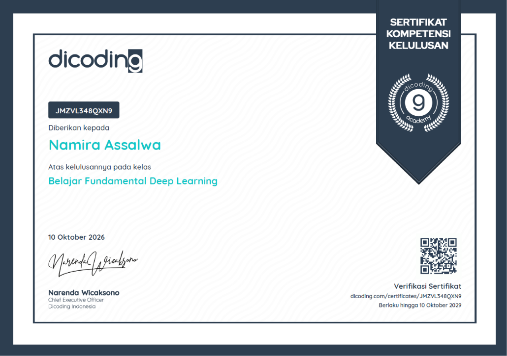

# 👕 Fashion MNIST Image Classification Project

This project is a deep learning implementation for image classification using the **Fashion MNIST** dataset (60,000 default training & 10,000 test data, combined and then re-split independently). It covers the complete machine learning lifecycle, from data preparation, data augmentation, CNN modeling, training with callbacks, evaluation, to model conversion.

> 📜 **Certification Context:** This project was developed as the final submission for the **Deep Learning Fundamentals** class in the **Dicoding Asah** program.  
> 

---

## 📚 1. Prerequisites & Libraries

The project requires the following libraries imported in the environment:

- `os`, `json`
- `numpy`
- `matplotlib.pyplot`
- `sklearn.model_selection` (`train_test_split`)
- `tensorflow` & `keras` (`datasets`, `layers`, `models`, `ImageDataGenerator`, `EarlyStopping`, `ReduceLROnPlateau`)

---

## 🗄️ 2. Data Preparation & Preprocessing

- **Data Loading & Splitting Structure:** In accordance with the submission criteria, the dataset is combined (70,000 images total) and split proportionally using `train_test_split`:
  - **Train Set (64%):** 44,800 images
  - **Validation Set (16% of total / 20% of the remaining train-val):** 11,200 images
  - **Test Set (20%):** 14,000 images
- **Normalization:** Pixel values are scaled to the range of `[0, 1]` by dividing by `255.0`.
- **Reshaping:** Channel dimensions are expanded to `(28, 28, 1)` for grayscale compatibility.
- **Data Augmentation:** Utilizes `ImageDataGenerator` with rotation, width/height shifts, zoom, and horizontal flips to improve generalization.

---

## 🧠 3. Model Architecture & Performance

- **Architecture:** Convolutional Neural Network (CNN) built using `Sequential` API comprising:
  - **Conv2D Layers:** Feature extraction with ReLU activation and padding.
  - **Normalization & Pooling:** Batch Normalization, MaxPooling2D, and Dropout layers to prevent overfitting.
  - **Global Average Pooling:** Summarizes spatial features.
  - **Dense Layers:** Fully connected layers featuring 512 units (ReLU, Dropout) and a final 10-unit output layer with **Softmax** activation for multi-class classification.
- **Performance & Training:**
  - _Training_ Accuracy: ~87% - 88%
  - _Validation_ Accuracy: ~85% - 88%
  - _Testing_ Accuracy: **88.41%**
  - **Callbacks:** `EarlyStopping` and `ReduceLROnPlateau` are implemented to optimize training efficiency.

---

## 📁 4. Model Output Formats

The trained model has been converted and saved into the three required formats:

1. **SavedModel / Keras:** `model_fashion.keras` and the `saved_model/` folder
2. **TensorFlow Lite (TFLite):** `tflite/model.tflite` along with the class label file `tflite/label.txt`
3. **TensorFlow.js (TFJS):** The `tfjs_model/` folder (containing `model.json` and _weights_ files)

---

## 🚀 5. How to Run the Project

1. Open Google Colab or Jupyter Notebook.
2. Upload the main _notebook_ (`.ipynb`) file.
3. Run the cells sequentially from top to bottom (_Run All_).
